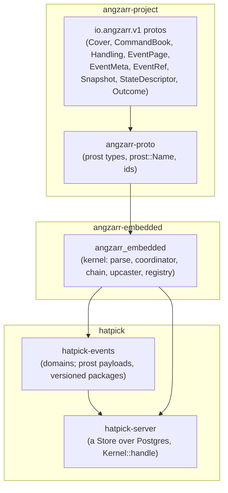

# The audited kernel on angzarr's proto types: design

Status: **implemented** in `crates/angzarr-embedded/src/`, pinned by the tests
beside it (`*.test.rs`). It is angzarr-embedded's one kernel.

The wire contract is angzarr's protos on angzarr-project's spec line
(`spec/20261019-draft`, the crate pinned at **a06c8ec**): `EventMeta.causation`
is the event's direct cause, with one arm, `command_id` (a process manager
is a domain whose inputs are commands and facts, so no event is caused by
another event); one `command_id` per command, deduplication on the events,
no actor, `StateOptions`/`StateDescriptor`, commands may be upcast;
and the record in angzarr's `docs/design/audit-meta/` (`decision-log.md`,
`idempotency.md`, `annals-divergence.md`) and
`docs/guide/state-and-conflicts.md`.

**Causation is the direct cause** (angzarr decisions 13.1 and 13.3). An
event's `EventMeta.causation` names what produced it: its command
(`command_id`, every command's event, a policy's and a fact's included).
A policy's command still names its trigger in
`CommandPage.causation_id`, the command's own causation (transport and
trace metadata, and the input its derived id hashes), but that is never
copied onto its events: the trigger-to-command edge belongs in tracing and
logs. There is no re-run switch: a policy command's id never names a rules
version, so a re-run deduplicates, and repairs are new commands (decision
13.4; see [Re-runs](#re-runs)).

## Why

People choose event sourcing for different reasons; here the main reason is
**auditability**. Every change should answer when it was made, in which
workflow, why (which command, and what caused it), and under which rules.
Replay should reproduce exactly what was seen at the time. Who made it is a
security question, answered by a separate security log, not by the events.
An architectural review of the root kernel found gaps in exactly those
places:

| ID | Finding | Resolution here |
|---|---|---|
| A1 | `Envelope` holds only seq, cause and event: no when, no why. Consumers put metadata in the payload (hatpick's `Stamp`). | Every event carries angzarr's `EventMeta`, stamped by the kernel. Business code emits payloads only. [Metadata](#metadata) |
| A2 | `cause` is only within a stream; there is no correlation id. | Every event names its direct cause, its command; a policy command names its trigger as its own `causation_id`; correlation is always set and kept through every policy step. [Identification](#step-2-identification), [Metadata](#metadata) |
| A3 | `Header.rules` is a free string replay never checks. | The rules version is the build's full version: registered, checked against every answer, stamped per event, and read only to choose which snapshots to offer. [Rules versions](#rules-versions) |
| A5 | `Header.schema` is unused; there is no upcasting. | A payload's type URL is its version. Old types are upcast by type URL, strictly, events at read and (discouraged) commands before decode. [Dispatch](#step-5-dispatch-through-angzarr-router) |
| A6 | Events emitted before a rejection stay in the `Stream`. | Decide is pure and stages its events; a rejection leaves nothing. |
| B1 | The old kernel's policy was a stateless saga with an undocumented target-contiguity invariant, its backlog replaying the source once per target. | One `Policy` trait and one registration list; every step committed on its own, with the policy's position on its source, and resumed by position. [Policies](#policies-and-the-chain) |
| B2 | `Projection::on` gets no stream identity or position. | Every handler gets a `Committed`: the cover, the sequence, the metadata, the event, the state just after. |
| B6 | The store port is synchronous, whole-stream, `u64`-keyed; `read -> Option` hides I/O failure. | angzarr-ports' async ports over opaque pages keyed by stream, one atomic `write` per step with its positions, `read`, `find_command`, continuity checks; `StoreError` separates conflict, caller bug, unreadable and unavailable. [The store port](#the-store-port) |
| B8 | Kernel faults are folded into business rejections. | `Failure` keeps the rejection apart from malformed input, kernel faults and failures down the chain, each classified for recovery. [Errors](#errors-and-recovery) |

## Layering



- **angzarr owns the wire contract.** angzarr-embedded defines no wire schema of its
  own for the kernel's events: its types are angzarr-proto's.
- **angzarr-embedded operates on the proto types directly.** The kernel depends on
  angzarr-proto and handles `v1::Cover`, `CommandBook`, `EventPage`,
  `EventMeta`, `EventRef`, `Snapshot`, `Uuid`, `ConflictResolution`,
  `StateDescriptor` and `AngzarrDeadLetter` as generated. There is no
  parallel stream key, event id, book, metadata, provenance, origin or UUID
  type, and so no mapping layer. Dependency-freeness was given up for this,
  deliberately: a mapping layer is a second home for every value, and every
  second home is a place for the two to disagree.
- **annals-angzarr is folded into the kernel.** What it held that was more
  than mapping lives on in `angzarr_embedded`: the `Payload` trait, `pack`,
  `type_name` and `Decoder`; the `Upcaster` (the in-process `UpcastPort`),
  for events and commands; the `Registry`, now also the
  mirror of `ComponentDescriptor.state`; and the golden replay fixtures. The
  opaque-row store adapter (`Opaque`, `Stored`) is gone: the store port
  itself is opaque now. The id helpers are angzarr-proto's own
  (`angzarr_proto::ids`, re-exported as `angzarr_embedded::ids`). One crate, not
  two, because with no mapping left the adapter would be a crate of
  re-exports.
- **angzarr-embedded is the in-process runtime**, embedded in hatpick's server. Each
  step of a chain is one atomic write: one stream's events with the step's
  policy positions.
  hatpick calls angzarr-embedded directly, in process: there is no HTTP or gRPC layer
  into angzarr-embedded, so no caller outside the process can deliver a policy command.
- **angzarr-embedded is not angzarr.** They share the protos, some code and their
  intents. Where the execution models differ, angzarr-embedded's choice is deliberate
  and listed under [Divergences](#divergences-from-angzarr).
- **Storage is opaque**: the encoded page as written and the metadata as
  typed columns. Typed views are projections; in hatpick they are replayed
  on read.

## Design constraints

- **angzarr-embedded does no I/O** and keeps no infrastructure. Its failures
  say whether to retry (`Recovery`), and a retry is always safe (it starts
  at the deduplication lookup). The kernel retries a step's retryable
  failure itself, capped, then dead-letters it
  ([retrying](#retrying-capped-then-dead-lettered)); its timer and the
  jitter's randomness are the application's (`Wait`), injected.
- **Pure and deterministic.** No clock, no randomness, no I/O and no
  hash-map iteration in the kernel (maps keyed by `Cover` are lookup only,
  since prost types have no ordering). The application samples the instant
  and mints the UUIDv7 a client's command without an id is given
  (`Sampled { now, command_id }`). UUIDv5 derivations are angzarr-proto's.
  The conflict nonce is a counter.
- **The kernel stays synchronous.** The only async parts are the async store
  port and the handler over it, with native `impl Future` in traits.
- **MSRV 1.89** (uuid 1.28, through angzarr-proto). **angzarr-embedded builds for
  `wasm32-unknown-unknown`**, angzarr-proto included; `just wasm` checks it.
- **Must not preclude hash chaining** (deferred). Stored pages are never
  rewritten; upcasting happens on read; metadata is deterministic; no
  personal data is in an event.

## The pipeline

One command, end to end, in angzarr's normative order (`types.proto`, the
`handling` region). Each step's output type is the next step's only input,
so the order cannot be skipped or reordered:

```text
CommandBook ─check──▶ Checked ─identify──▶ Identified ─deduplicate (admit)──▶ Deduplicated
                                                         ├─ Duplicate { events }            (answer: DUPLICATE)
                                                         ├─ Skipped                         (a PM's non-starting fact)
                                                         └─ Novel ─load──▶ Contextual
                                                                     ─dispatch (router)──▶ stamped pages
```

1. **Validate** (`check`): domain-blind, everything at once.
2. **Identify** (`Checked::identify`): command id, correlation, causation.
3. **Load, then admit** (`deduplicate`): the conflict
   resolution, the snapshot and events are loaded **first**; then the
   command id is looked up (`find_command`) and the kernel admits the
   input (decision 14.42; the router admits nothing): a refusal
   fact's address, deduplication by the events found (they are the
   answer), a process manager's start rule (below).
4. **Resolve** (`load`): the expected sequence stamped or
   checked against the head step 3 loaded (STRICT's stale refusal is
   here), the window and nonce.
5. **Dispatch** (`dispatch`): the `ContextualCommand` through the domain's
   router (its `CommandHandler`), whose handler decides a command or
   records a fact; the kernel stamps the events it answers.

Steps 3 to 5 are the kernel's own (`pub(crate)`): the chain runs them, and
`Kernel::handle` is the one entry.

**The load comes before the lookup**, so a concurrent commit of the same
command cannot slip between them (see *Races* below). **Deduplication
comes before the sequence check**, so a retry of an applied
command whose expected sequence is now stale is answered DUPLICATE, never
stale. **Validation comes before deduplication**, so a malformed retry of an
applied command is still malformed. **Decoding comes after both**, so an
unknown command type is refused only for a command that is new and current.

## Step 1: one check

```rust
pub fn check(book: CommandBook, registry: &Registry) -> Result<Checked, Malformed>;

impl Checked {
    pub fn cover(&self) -> &Cover;            pub fn domain(&self) -> &str;
    pub fn root(&self) -> &Uuid;              // present, 16 bytes
    pub fn edition(&self) -> Option<&str>;    // None: main; never Some("")
    pub fn body(&self) -> &Body;              // Command { payload } | Fact { payload, source }
    pub fn payload(&self) -> &Any;
    pub fn command_id(&self) -> Option<&Uuid>;       // the sender's, 16 bytes if set
    pub fn correlation_id(&self) -> Option<&Uuid>;
    pub fn expected_sequence(&self) -> Option<u64>;
    pub fn conflict_resolution(&self) -> Option<ConflictResolution>;   // supported if set
    pub fn is_policy_command(&self) -> bool;
    pub fn identify(self, sampled: &Sampled) -> Identified;
}
```

`check` is **the one place a `CommandBook` is checked**. It takes the book
apart once; what it returns holds the required parts outside their prost
`Option`s, so nothing downstream unwraps one. The accessors that stay
`Option` are the sender's genuine choices. `Body` attaches `fact_origin` to
the fact arm, so a fact's source is never optional.

**Domain-blind.** `check` knows no domain's types. It asks the `Registry`
only what angzarr's coordinator reads off a `StateDescriptor`: is
`cover.domain` registered, and which resolutions does its state support.

**Malformed**, in the order tried (the first that applies is the answer):
no cover; an unregistered domain; no root; a root that is not 16 bytes; a
set empty edition; no page; no body; no payload; a set command or
correlation id that is not 16 bytes; a causation from a client
(`CausationFromOutside`); for a policy's book, ids of its own
(`IdOnPolicyCommand`), a fact (`FactFromPolicy`) or handling
(`HandlingOnPolicyCommand`), or a trigger that cannot name an id (`BadTrigger`);
a fact without `fact_origin`; an empty `external_id`; a command with a
`fact_origin`; a fact whose `command_id` is not its derivation; a fact with
**any** handling field (`HandlingOnFact`); a `conflict_resolution` value the
build does not know; a resolution the domain's state does not support
(COMMUTATIVE on a state without conflict units, above all). **An empty
`Handling` is unset**: the same as none.

**No causation from outside.** `check` is the client entry. The kernel's
chain builds its policies' books itself and checks them through a
crate-private entry (`check_policy_command`) that applies the same checks plus
the policy-command rules and derives the command id from the trigger. angzarr-embedded
needs no authentication for this: no one outside the process can call it.

## Step 2: identification

```rust
pub struct Sampled { pub now: Timestamp, pub command_id: Uuid }   // the application's v7

impl Identified {
    pub fn command_id(&self) -> &Uuid;            // never absent
    pub fn correlation_id(&self) -> &Uuid;        // never absent
    pub fn causation_id(&self) -> Option<&EventRef>; // the command's (CommandPage), never its events'
    pub fn meta(&self, recorded_at: Timestamp, rules_version: &str) -> EventMeta;
    pub fn to_book(&self) -> CommandBook;         // ids filled: for a dead letter or an audit line
    // and the Checked accessors
}
```

| Kind | `command_id` | `correlation_id` | `causation_id` |
|---|---|---|---|
| a client's command | as sent, else `Sampled::command_id` (a UUIDv7 the application minted) | as sent, else the command id | none |
| a fact | `ids::fact_command_id(external_id)` (UUIDv5; a sent one must equal it) | as sent, else the same value (`ids::fact_correlation`) | none |
| a policy's command | `ids::policy_command_id(trigger, component, index)` (UUIDv5) | the trigger's | the trigger's `EventRef` |

`component` is `Policy::NAME`; `index` is the order's place among those
the trigger set off for that policy. The `causation_id` column is the
command's own (`CommandPage.causation_id`); `Identified::meta` stamps the
events with `causation.command_id` only. Identification is infallible: the
check refused everything that could make it fail. Text forms of ids exist
only at display and input (`Display`/`FromStr` on `v1::Uuid`).

## Step 3: deduplication

**By `command_id`, on the events.** There is no key store, no claim, no
fingerprint and no commands table. "Already applied?" means "the addressed
stream holds events whose `EventMeta.command_id` is this one":
`EventStore::find_command(stream, command_id)`, over a non-unique index on
(stream, command_id). On a hit the answer is `Handled::Duplicate` with those
events, in sequence order (angzarr's DUPLICATE), and nothing below runs.
Because the id is written with the events, the record of having applied a
command is atomic with its effects, with nothing else to keep consistent.
(KurrentDB deduplicates appends by event id the same way, and Equinox keeps
processed ids in the stream.)

**Accepted costs** (the first two are angzarr's decision 12.2, the same in
both runtimes; the third is angzarr-embedded's own, divergence 9):

- **A decision that produced no events leaves nothing to find**, so a
  redelivery of it is decided again, against the stream as it is then
  (Equinox-style), and answered APPLIED. Pinned by
  `a_zero_event_decision_is_decided_again`.
- **A command id reused for a different command goes undetected**: it is
  answered DUPLICATE with the first command's events. Payloads are not
  fingerprinted; a client mints a new id for every new command.
- **Deduplication lasts as long as the stream.** There is no expiry or
  retention window, but a store that opts in can purge a stream (see
  [the store port](#the-store-port)), and a purge deletes its command
  ids with its events. A command redelivered after its stream is purged
  finds nothing, so it is decided again against the stream as it is then;
  a creating command re-creates the stream, from sequence 0. An
  application that purges bounds this by purging only streams quiet for
  longer than any redelivery it expects to see. Pinned by
  `a_creating_command_redelivered_after_a_purge_creates_its_stream_again`.

Rejections leave nothing, so a rejected command's retry runs again. Each
policy command takes step 3 too (cheap, and uniform): a step run again
after a crash finds its own events and writes only its position, so a
chain never applies one command twice.

**Races.** Two deliveries of one command race on the append's sequence
check: one commits; the other's commit fails `StoreError::Conflict`
(`Recovery::Retry`). Run again with the same command id in a fresh unit of
work, it starts at step 3 and finds the winner's events. **This needs the
load before the lookup**, under READ COMMITTED: had the lookup run first, the
original could commit between it and the load, and the retry, finding
nothing and loading the new head, would append after the original's events
with no conflict: applied twice. Loading first, a commit after the load is
either seen by the lookup or makes this delivery's append fail its expected
head. Pinned by `a_retry_racing_its_original_commit_is_never_applied_twice`
(a store that lets a commit land after the first read).

**Same-stream concurrency is optimistic** (decision 14.45). Two commands
to one stream at once both load and both decide; the store takes the
first write and refuses the second (`StoreError::Conflict`). Nothing
orders or locks streams: ordering is per stream only, and a write to
another stream is never a conflict. The loser:

- **set no expected sequence** (or is a fact): the kernel stamped the
  head it loaded, so the race is the kernel's own. It is loaded and
  decided again on the new head, for an outside caller as for a policy's
  step, under the race re-run cap (`OnRetryable::max_race_runs`, default
  10 runs, the first included; decision 14.46), with the retry policy's
  backoff and jitter between runs, whatever `max_retries` says; its
  handler runs once per run. A race re-run cap of 0 turns this off, for a
  caller that owns its retry loop: the first lost race goes back to the
  caller as the store's `Conflict` (retryable), not dead-lettered; a
  policy's step that loses it holds the policy's position at the
  trigger (nothing was dead-lettered, so nothing moves past it), and
  the next catch-up runs the step again.
- **set one, under STRICT**: it decided against a head that is gone, the
  early check's condition found late: `KernelError::Stale`, `expected`
  its sequence and `actual` the head the store found, ABORTED under
  `COORDINATOR_REASON_EXPECTED_SEQUENCE_STALE` (`KernelError::as_coded`),
  back to an outside caller at once and never run again by the kernel.
- **set one, under AGGREGATE_HANDLES or COMMUTATIVE**: never that key (it
  is STRICT's alone). The widened window (its expected sequence to the
  new head) is re-delivered with a fresh nonce, and the resolution's rule
  decides again on it (the nonce, or unit overlap), under the retry cap:
  at most `max_retries + 1` deliveries, the first included, the retry
  policy's backoff between them.

At either cap the kernel gives up: the command is dead-lettered under
`KernelError::RetryCapExhausted` (args `attempts`, how many times business
code ran, and `cap`), nothing is persisted, and its caller is answered
INTERNAL, `COORDINATOR_REASON_RETRY_CAP_EXHAUSTED` (`KernelError::as_coded`):
the dead letter holds it, so no caller retries it, and a policy's step
moves its position as `on_policy_bug` says. A fact is never refused: at the
race re-run cap it is dead-lettered the same way and answered
`Handled::Parked` (OK, PARKED, no events).

Pinned by `src/concurrency.test.rs`, which forces the race with a barrier
only the two first dispatches pass; by `src/races.test.rs`, whose
business code lands the other write through the store while it decides
(conflict_resolution.feature's C-0718, C-0719 and C-0722 to C-0726); and by
the injected conflicts of `an_outside_callers_lost_race_*` and
`outside_strict_a_lost_write_is_never_the_stale_key`.

## Step 4: load and conflict resolution

```rust
pub(crate) struct Contextual {          // angzarr's ContextualCommand, in process
    resolution: ConflictResolution,     // never UNSPECIFIED
    expected: u64,                      // the book's, or the head
    head: u64,
    snapshot: Option<Snapshot>,
    pages: Vec<EventPage>,              // the window is expected .. head
    nonce: Option<Vec<u8>>,             // ContextualCommand.conflict_nonce
    /* the command, the last recorded_at */
}
```

The **in-process coordinator** is the chain's steps 3 and 4, over the
store, domain-blind like angzarr's: they see covers,
pages and the registry. There is no service and nothing is sent.

**The resolution** (`Registry::resolve`, angzarr's precedence, highest
first): the book's `Handling.conflict_resolution`; the domain's
configuration for the command's type (`Domain::CONFLICT_RESOLUTION_BY_COMMAND`,
by full type name, looked up by the command's current type after upcasting,
so an old command type has its current type's setting; a payload whose
upcast fails is looked up as sent, and decoding reports the failure); the
domain's own (`Domain::CONFLICT_RESOLUTION`); the
built-in default, **COMMUTATIVE where the state declares conflict units,
otherwise STRICT**. Configuration a state does not support is refused at
registration (`Misconfigured::UnsupportedResolution`); a book's request, at
step 1.

**The load.** The newest snapshot, if usable (its state's type URL is the
registered state's and its rules version compatible with the registered
one, [Snapshots](#snapshots); otherwise it is not offered and the stream
is replayed from 0, never migrated), then the events
after it to the head. Under AGGREGATE_HANDLES and COMMUTATIVE the snapshot
used is **at or below expected−1**, so no part of the window is hidden in
snapshot state; a newer one is not used.

**The expected sequence.** Absent: stamped with the head, and the command
can never be stale (a race lost at its write is run again on the new head;
*Races*, above). Present:

- **STRICT**: it must equal the head, else `KernelError::Stale` (angzarr's
  ABORTED, `COORDINATOR_REASON_EXPECTED_SEQUENCE_STALE`, args `expected`
  and `actual`), before anything is decoded; a race lost at its write is
  the same `Stale`.
- **AGGREGATE_HANDLES**: the events from it to the head are the window;
  the handler receives them with the nonce (the router's
  `CommandContext.conflict`) and must give the nonce back
  (`Conflict::resolve_conflicts`). The router reports the nonce handed
  back (`CommandHandlerResponse.conflict`), and the kernel keeps the
  events only if it is the one delivered, else the command fails
  (COORDINATOR_REASON_CONFLICT_UNRESOLVED, the kernel's `KernelError::Unresolved`) and
  nothing is persisted.
- **COMMUTATIVE**: the same window and nonce; the router computes the unit
  sets and the kernel judges them (below).
  At the head there is no window, and the command is handed over as
  STRICT.
- **Past the head**, under every resolution: malformed, never stale
  (decision 14.47): `KernelError::ExpectedSequenceAhead`, angzarr's
  INVALID_ARGUMENT `COORDINATOR_REASON_EXPECTED_SEQUENCE_AHEAD`, args
  `expected` and `head`, before business code (C-0727).

**COMMUTATIVE**, angzarr-router's (`DomainDispatch::with_commutative`,
which the registry configures for a state that lists it). The handler runs
on the head, so every invariant it checks holds against the window's
effects. Then `window = changed(state at expected, head)` and `mine =
changed(head, head with the command's events)`, both by the state's
generated `State::changed`, reported to the kernel in the router's
`ConflictReport`. The kernel judges (decision 14.42, `conflict::judge`):
the events are kept iff the two do not overlap (options.proto's rule:
equal units or a prefix at a `.`/`[` boundary; a wildcard overlaps any
non-empty set; an empty set nothing), else the command is stale
(COORDINATOR_REASON_CONFLICT_OVERLAP, the kernel's `KernelError::Overlap`, naming both unit
sets as `window_units` and `command_units`) and nothing is persisted. Unmarked fields conflict with
everything (the fail-safe wildcard), so an unmarked change only makes
COMMUTATIVE stricter.

**The `State` trait** is what angzarr's generator emits for a state message
from its `(io.angzarr.v1.state)` option and `(io.angzarr.v1.conflict)` field
markers:

```rust
pub trait State: Default + Clone + Send + 'static {
    type Snapshot: prost::Message + prost::Name + Default;   // the wire form a snapshot carries
    fn to_snapshot(&self) -> Self::Snapshot;
    fn from_snapshot(snapshot: Self::Snapshot) -> Result<Self, Report>;  // a wire value need not be a valid state
    fn descriptor() -> StateDescriptor;     // type URL (the snapshot form's) + the full resolved list of resolutions
    fn changed(before: &Self, after: &Self) -> Units { Units::everything() }
}
```

The state is a domain type and its snapshot form the prost message: a
snapshot that decodes but is not a valid state (`from_snapshot` refuses it)
is unreadable, `PayloadError::Invalid`. A state that is itself a prost
message is its own snapshot form. `Registry::register::<D>` fills its entry
from `D::State::descriptor()`, as angzarr's `registry.register::<D>()` fills
`ComponentDescriptor.state`, and refuses a descriptor whose type URL is not
the snapshot form's. angzarr's generator (backlog CR-1, CR-4) emits the impl;
the test fixtures write it by hand (`src/toys.test.rs`).

**The risk of COMMUTATIVE.** No structural diff sees a value derived from,
or meaningful only together with, another unit: a total over items, two
fields that must change together. A stale caller's intent can then merge
when it should not. That is a modelling failure: put dependent data in one
unit (mark the containing message without `descend`), derive the value in
decide or a projection rather than storing it, or configure that command
type STRICT. angzarr's `docs/guide/state-and-conflicts.md` shows the
failures and their fixes; it applies to angzarr-embedded unchanged.

## Step 5: dispatch through angzarr-router

```rust
pub trait Domain: Sized + 'static {
    type State: State;
    type Command: Payload + Send + 'static;
    type Fact: Payload + Send + 'static;           // Infallible: none
    type Event: Payload + Clone + Send + Sync + 'static;
    type Rejection: Diagnostic + Send + 'static;   // what its handlers refuse with
    const NAME: &'static str;                      // the Cover.domain; the registry key
    const RULES_VERSION: &'static str;             // the build's version: env!("CARGO_PKG_VERSION")
    const CONFLICT_RESOLUTION: Option<ConflictResolution> = None;
    const CONFLICT_RESOLUTION_BY_COMMAND: &'static [(&'static str, ConflictResolution)] = &[];
    fn apply(state: &mut Self::State, event: &Self::Event);
}

impl Registry {
    pub fn register<D: Domain>(&mut self, upcaster: Upcaster,
        handlers: impl FnOnce(DomainDispatch<D::State>) -> DomainDispatch<D::State>)
        -> Result<(), Misconfigured>;
    pub fn command_handler(&mut self, domain: &str, handler: impl CommandHandler + 'static,
        descriptor: ComponentDescriptor) -> Result<(), Misconfigured>;
    pub fn remote(&mut self, domain: &str, coordinator: impl CoordinatorPort + 'static)
        -> Result<(), Misconfigured>;
    pub fn target(&self, domain: &str) -> Option<Target<'_>>;  // Local(&dyn DynCommandHandler) | Remote(&dyn CoordinatorPort)
}
```

The kernel awaits each dispatch (angzarr-router's `CommandHandler`,
`PolicyComponent` and `ProjectorHandler` return futures; it holds them as
their boxed twins, `DynCommandHandler` and the rest). Business code stays
synchronous: an in-process handler answers at once, a remote child's call
is awaited.

**The routing seam** (the `target` module). The registry resolves a domain name
to a `Target`: `Local`, the pipeline above over the kernel's store,
through its handler (in this process or a child's); or `Remote`, a
`CoordinatorPort`, a coordinator elsewhere that owns the domain's streams
(`CommandHandlerCoordinatorService.Handle`). A domain is one or the other,
never both (`Misconfigured::AlreadyRegistered`). A command for a remote
domain, the application's or a policy's step, is checked and identified
here, its command id fixed before it leaves so a retry is deduplicated
there, then handed to the port; nothing of its stream is loaded or written
here. **Remote stays remote** (owner rulings, 2026-10-30): a correlation
its sender left unset is forwarded unset, so the remote coordinator
applies its own defaults (a process manager's root, decision 14.31); and
a policy or projector here whose source is a remote domain is refused at
registration, in either order (`Misconfigured::RemoteSource`), since that
domain's events are never here. Its answer comes back as a local domain's: its events (in the
chain's books, not among the steps written here), DUPLICATE, or a refusal
by its status's class. A policy's position is written here as ever. Only
the seam is the kernel's: a transport behind the port is the composition
root's.

**Business dispatch is angzarr-router's**, implemented once for every
runtime: handlers and typed refusals. The kernel keeps the check,
identification, upcasting, admission, snapshots, a policy's output checks,
the store reads and writes, positions, resume and the edition-not-forked
refusal.

**A policy's answer is the kernel's to check** (decision 14.42). The
kernel runs a policy through angzarr-router's `PolicyComponent` (a
`PolicyDispatch`, or one in another process: `Registry::policy_component`,
given the output domain its descriptor names),
one triggering event at a time, and holds every command of each reaction
(`PolicyResponse.reactions`, by triggering page) to these rules
(`check_reactions`): the policy's one destination
(`COORDINATOR_REASON_POLICY_COMMAND_OUTSIDE_DESTINATION`), the trigger's edition, an unset one
stamped with it (`COORDINATOR_REASON_POLICY_COMMAND_OUTSIDE_EDITION`), a named root
(`COORDINATOR_REASON_POLICY_COMMAND_NO_ROOT`), no Handling, which only the target stamps
(`COORDINATOR_REASON_POLICY_COMMAND_WITH_HANDLING`), a Command, never a Fact
(`COORDINATOR_REASON_POLICY_COMMAND_IS_FACT`), with no `fact_origin`
(`COORDINATOR_REASON_POLICY_COMMAND_FACT_ORIGIN`), the trigger's correlation, if any
(`COORDINATOR_REASON_POLICY_COMMAND_OTHER_CORRELATION`), and no command id or causation
other than the one the kernel stamps (`COORDINATOR_REASON_POLICY_COMMAND_OTHER_IDENTITY`,
naming the `field`). One failure refuses the whole answer
as the policy's bug: nothing is delivered, the trigger is dead-lettered
and the position stays.

**A domain is a router table.** `Registry::register` builds angzarr-router's
`DomainDispatch` over `D::State`: it folds each event, upcast by the kernel
before it is handed over, through `D::apply`, and answers
`D::RULES_VERSION` with every decision; a state with a snapshot form has the state's codec (`with_state_codec`: a
delivered starting state restored onto a fresh state, and the state every
answer carries); and it resolves COMMUTATIVE by `State::changed`. The
domain's handlers are registered on it: `#[aggregate]` and
`#[process_manager]` generate them (`markup::Routed`); a hand-written
domain registers its own (`on_command`, `on_fact`, `on_refused`).
`Registry::command_handler` registers any `CommandHandler` (a
`DomainDispatch` built by hand, or a handler in another process behind
one) with its `ComponentDescriptor`: its state descriptor, rules version
and a process manager's starting types. `Kernel::handle_any` handles books
for such a domain.

**Where a descriptor comes from** (decision 14.42: no component carries
one; they are generated). A marked-up process manager's starting types are
its markup's: the macro generates `markup::ProcessManager::STARTS` from the
inputs marked `starts`, the same list angzarr-build writes into its
descriptor, and `Registry::process_manager` reads it. A typed domain's
state descriptor is its `State::descriptor()` and its rules version
`D::RULES_VERSION`, which the markup gives as its crate's
`CARGO_PKG_VERSION`: the version angzarr-build writes into its
descriptor. A domain registered by `Registry::command_handler` is given
its descriptor: an application's, decoded from the `angzarr-descriptors.rs`
angzarr-build generates, or, for a child, the one it answers `Describe`
with (angzarr-embedded-host). The kernel does not read
`angzarr-descriptors.rs` itself: that would make angzarr-build (angzarr-cli's)
a dependency of the kernel and of its tests, and the markup already holds
every fact the descriptor has.

**The kernel upcasts every incoming payload** (decision 14.39) before it
decides anything by its type (the resolution per command type, a process
manager's start rule) and before dispatch, through the domain's
`UpcastPort`: a typed domain's `Upcaster`, or the port
`Registry::upcast_with` gives a domain registered as a bare
`CommandHandler` (its upcaster sidecar). The payload goes as a one-page
`UpcastRequest`; the router is handed the current type only. A payload
whose upcast fails is `KernelError::Upcast`, reported after the sequence
check. The stored events it hands on go through the same port (C-0584,
C-0586): a load's for the router, as one request, and each event a policy
reads, one page at a time; the router upcasts nothing.

**Dispatch.** The kernel hands the router the `ContextualCommand`: the
usable snapshot and the events after it (upcast), the command with its ids
and its handling resolved, the nonce, and the instant the input is
accepted at (`ContextualCommand.recorded_at`). An unknown command type is
the router's ROUTER_REASON_UNKNOWN_COMMAND_TYPE, an unknown fact type ROUTER_REASON_NO_FACT_HANDLER, a
refusal its source has no handler for ROUTER_REASON_NO_REFUSAL_HANDLER: the router's own
errors on malformed input, INTERNAL, bugs. The kernel answers the first two
with `type_url` the type as sent and `upcast_type_url` the type the router
was handed (the same when no rule applied).

**Four classes of error, by gRPC status** (decision 14.37 and the owner's
rulings of 2026-10-29), decided by the kernel itself in one place
(`angzarr_embedded::class`, decision 14.42; the router answers a status and a key and
never classifies):

| Class | Statuses | What the kernel does |
|---|---|---|
| business, fatal | FAILED_PRECONDITION, INVALID_ARGUMENT, NOT_FOUND, ALREADY_EXISTS, OUT_OF_RANGE, PERMISSION_DENIED | a rejection, `Failure::Rejected(Rejected)`, `Recovery::Business`: to the caller, or the issuing policy's refusal path; never retried, never dead-lettered |
| business, immediate | ABORTED (a stale or overlapping command, a STRICT command's lost race with its sender's expected sequence, or a handler's own choice) | back to an outside caller at once, to reload (`Recovery::Retry`), never dead-lettered; a policy's step, whose caller is the kernel, is reloaded and run again under the capped backoff, then dead-lettered. Any other race lost at the write is run again for any caller, under its cap (*Same-stream concurrency*) |
| bug, fatal | INTERNAL, UNKNOWN, DATA_LOSS | `KernelError::Router`, `Recovery::Bug`, dead-lettered at once |
| bug, retryable | every other status (UNAVAILABLE, DEADLINE_EXCEEDED and RESOURCE_EXHAUSTED, a handler's in process or a remote child's as it picked them; UNIMPLEMENTED; a remote child's CANCELLED or UNAUTHENTICATED, and a call that failed on the way, arrive UNAVAILABLE) | retried under the capped backoff, then dead-lettered; `Recovery::Retry` |

A handler's refusal carries its code and args (a typed refusal is keyed
ROUTER_REASON_COMMAND_REFUSED, its object's type as `refusal_type`, the object beside).
A marked-up command handler, typed-refusal handler or continuation step
fails with `markup::Failed`, one variant per class:

- `Failed::Rejected` (business, fatal): a refusal under its business
  status (FAILED_PRECONDITION by default; any of the six with
  `Failed::with_status`, a typed refusal still keyed ROUTER_REASON_COMMAND_REFUSED, and
  `Rejected::status` reads it back).
- `Failed::Immediate` (business, immediate; `Failed::immediate(&why)`):
  ABORTED under `why`'s own code and args, angzarr-router's
  `CodedError::immediate`: back to an outside caller at once, nothing
  written; a policy's step reloaded and run again under the cap, then
  dead-lettered.
- `Failed::Bug` (bug, fatal; `Failed::bug(&broke)`): angzarr-router's
  `CodedError::bug`, INTERNAL ROUTER_REASON_UNHANDLED_HANDLER_ERROR, dead-lettered at
  once.
- `Failed::RetryableBug` (bug, retryable;
  `Failed::retryable_bug(status, &down)`): angzarr-router's
  `CodedError::retryable_bug`, ROUTER_REASON_UNHANDLED_HANDLER_ERROR under the
  `markup::RetryableStatus` the handler picks, its cause as a fatal bug's;
  retried under the cap ([below](#retrying-capped-then-dead-lettered)),
  then dead-lettered with its `retry_count`.

The retryable statuses are not interchangeable. UNAVAILABLE
(`RetryableStatus::Unavailable`) means resend: the dependency is down for
now. DEADLINE_EXCEEDED (`DeadlineExceeded`) means resend only if the call
is idempotent, since the work may have happened; a command is, by its
`command_id`, which the kernel deduplicates on, so the kernel resends it.
RESOURCE_EXHAUSTED (`ResourceExhausted`) means wait longer before
resending: a quota or a capacity limit was hit. Each goes out exactly as
the handler picked it.
A handler fails deliberately as a bug with angzarr-router's
`CodedError::bug`, which answers ROUTER_REASON_UNHANDLED_HANDLER_ERROR with the
handler's own code and args as its cause (`cause=<code>`,
`cause.<arg>=<value>`); the router catches a handler's panic, its cause
ROUTER_REASON_HANDLER_PANICKED, and an error without a code of its own is
ROUTER_REASON_UNHANDLED_HANDLER_ERROR too. Every router reason is forwarded under an
angzarr-embedded code of its own (`angzarr-embedded-<reason>`, the reason without its
`ROUTER_REASON_` or `COORDINATOR_REASON_` prefix), each
with its own message; a handler's own code that no catalog holds is
`angzarr-embedded-unhandled-handler-error` with that code its
`cause`. A remote handler that cannot be reached
(`COORDINATOR_REASON_HANDLER_UNAVAILABLE`, UNAVAILABLE) is
`KernelError::HandlerUnavailable`, a retryable bug. The kernel's limits
travel under the spec's keys too (decision 14.49): a chain deeper than its
limit is `COORDINATOR_REASON_CHAIN_TOO_DEEP`, a decision past its step limit
`ROUTER_REASON_TOO_MANY_STEPS`, each INTERNAL with its `limit`; a policy's
command for a domain the kernel cannot route is
`COORDINATOR_REASON_POLICY_COMMAND_UNKNOWN_DOMAIN`.

**What a handler reads.** The router's `CommandContext`: the stream, the
input's command id, correlation and fact origin, the conflict under
AGGREGATE_HANDLES, and the instant the input was accepted at, its
`recorded_at` (`max(Sampled::now, the stream's last)`): the kernel stamps
it on the `ContextualCommand`, the events are recorded at it, and a
marked-up handler's `Context` reads it there.

**Facts** are recorded, never refused: a fact handler returns its events
(the router's `FactRecord`: the first as the record, the rest as its flags).
A panicking fact handler is a bug: the router catches it
(ROUTER_REASON_UNHANDLED_HANDLER_ERROR, cause ROUTER_REASON_HANDLER_PANICKED), the chain fails
(`KernelError::Router`, `Recovery::Bug`), nothing is written, and the
kernel logs a [dead letter](#dead-letters-a-logger).

**Business output is payloads only.** The kernel builds the pages: their
sequences and their `EventMeta` (`Identified::meta`).

## Metadata

Every event carries angzarr's `EventMeta`, the same in both runtimes:

| Field | angzarr-embedded stamps |
|---|---|
| `causation` | the event's direct cause, `command_id`: the producing command's (step 2: a client's, a fact's or a policy's), its deduplication key |
| `fact` | the fact's `FactOrigin`, for a fact; unset otherwise |
| `correlation_id` | the producing command's; never unset |
| `recorded_at` | `max(Sampled::now, the stream's last recorded_at)`: non-decreasing per stream, one instant per chain, so as-of-time reads are prefixes |
| `rules_version` | the version the answer reports, in full, which must be the registered one (an answer reporting another is refused, `KernelError::RulesVersionMismatch`, with nothing kept) |

**No trigger on a policy command's events**: a policy's command names its trigger
(`CommandPage.causation_id`), its events name the command. The edge from
trigger to command is the command's own causation, for tracing. Readers find a policy command's events by
correlation and group them by `command_id`.

**No actor**, anywhere: who did it belongs in the deployment's separate
security log, written by the application with the command id, so erasing
or rotating personal data never touches an event. **No base sequence**: the
events of one command are grouped by `command_id`, and the version decided
against is the first one's sequence. Business time (a deadline, a draw's
instant) belongs in the payload, where `apply` sees it; a handler copies
its context's `recorded_at` there when the domain needs it.

A decoded event is an `Envelope<E>`: a checked `EventPage`, its metadata's
required fields outside their `Option`s (`causation()`, the generated
`v1::event_meta::Causation`; `correlation_id()`, `recorded_at()`,
`rules_version()`; `command_id()`, the one arm of `causation()`), its
payload decoded. A stored page
whose meta lacks one is `ReplayError::IncompleteMeta`.

## Process managers

A process manager is a domain (angzarr decision 14.31). Its inputs are
commands, which policies send it, and facts (timeouts, webhooks); it never
subscribes to another domain's events. So angzarr-embedded needs nothing of its own
for one: its commands and facts take the five steps like any domain's, its
events name the command or the fact's derived id as their cause, and its
deduplication is `find_command`'s, by command id and fact id. Its start
rule is the kernel's: for a stream with no instance, an input whose type
name after upcasting is not one of its descriptor's `starting_types` is
refused `COORDINATOR_REASON_PM_NO_INSTANCE` if a command and skipped if a fact (decisions
14.41 and 14.42), a remote process manager's as an in-process one's. Its root is
the one its input names, whatever the input's correlation (decision 14.36):
one instance may take inputs of several correlations, its events carrying
each input's; a correlation left unset is given the root.

## Rules versions

A rules version is the full version of the build that decides
(`"1.4.2+build.7"`), never a label chosen by hand: an in-process Rust
domain's is its crate's `CARGO_PKG_VERSION` (`Domain::RULES_VERSION`), the
same value angzarr-build writes into its descriptor, and a child's is its
descriptor's. The domain is registered at it; a child restarted on a new
build is described again and registered at its new version before it gets
work (C-0563). Every answer reports it, and an answer reporting another
version than the registered one is a handler bug: refused, nothing kept,
dead-lettered (C-0558). The kernel stamps it in full on every event and
snapshot, and reads it only to choose which snapshots to offer
([Snapshots](#snapshots)); replay never reads it. A rules change therefore
never needs a snapshot migration: the next load replays.

## Policies and the chain

```rust
pub trait Policy: Send + Sync + 'static {
    const NAME: &'static str;            // its commands' component; its position's handler
    type Source: EventSource;            // a Domain, or a child-hosted domain's name and events
    type Target: CommandTarget;          // a Domain, or a remote domain's name and commands
    const ANSWERS_REFUSALS: bool = false; // every marked-up policy answers them
    fn on_event(&self, event: &Any, ctx: &PolicyContext)
        -> Result<Option<Commands<Self::Target>>, Report>;
    fn on_refused(&self, refusal: &Refusal, ctx: &CommandContext)    // the refused command's, whole
        -> Result<Any, Report> { /* CommandRefused, passed through */ }
}
pub trait Projection<D: Domain> { fn project(&mut self, c: &Committed<'_, D>); }

registry.policy(ListToDrawSystems);                          // ONE list, in registration order
let kernel = Kernel::new(&registry, &dead_letters);          // .limit(n), default 8
kernel.handle::<List, _, _>(&store, book, &sampled, &mut projections).await?;   // -> Handled
kernel.resume(&store, &sampled, &mut projections).await?;                       // -> Recorded
```

- **One policy trait, one list.** A hand-written policy implements
  `Policy`; `#[policy]` generates the same impl (answering refusals). Every
  policy is registered in the registry's one list, and for each event of a
  source, every policy of that source runs in the order registered.
- **Policies emit commands only.** Facts come from outside the system, so
  there is no policy-injected fact. A policy's command is a `CommandBook`
  the kernel builds (the target's cover, the command packed as `Any`, no
  ids, no handling), checked and identified from its trigger, then taken
  through steps 3 to 5 in its target.
- **Every step is committed on its own.** Atomicity covers ONE handling
  step, never a chain: a step is one atomic write to the store (see *The
  store port*), one stream's events at the length the step loaded, with
  the step's positions. The command's write comes first; then each policy
  of its domain runs on those events, each of its commands a step of its
  own in its target, the policy's position on the source written with the
  trigger's last target's step (or alone, when no step writes it). A step
  that writes events sets off its stream's policies in turn: the chain
  settles stream by stream in the order written, and the call waits for it.
- **A failing step keeps every write before it.** Nothing is rolled back.
  The call fails with the path to the step (`Failure::Downstream { path,
  error }`, the path a list of `Step { stream, cause }`). A refused command
  of a policy that does not answer refusals is dead-lettered and its
  position moves past it. A policy's own error and a handler's bug in the
  step are dead-lettered and move it past too, unless the kernel says to
  stay ([below](#a-policys-bug-and-its-position)). Any other bug (a
  malformed policy book, the depth limit, the kernel refusing the policy's
  answer) or a store failure writes nothing more: the position stays where
  the last committed step put it, and `resume` runs the step again.
- **A refusal is a fact.** A policy that answers refusals (every marked-up
  one) is not failed by its target's refusal: its `on_refused` answer goes
  to the stream of the triggering event as a fact, a step of its own,
  whose id is the refused command's and whose cause the trigger; a refusal
  its source has no handler for is dead-lettered. The target recorded
  nothing. The kernel builds and addresses every refusal fact (decision
  14.42): the policy answers a translated payload, or none, and with none
  the kernel passes the refusal through as angzarr's `CommandRefused`. A
  translated fact on the wire that is more than a payload (its own cover,
  handling or identity, no page, not a fact) is the policy's bug.
- **Resumed by position.** A policy's position on a source stream is the
  next sequence it has yet to handle, in angzarr-ports' `PositionStore`.
  `Kernel::resume` runs, for every stream of every policy's source, each
  policy on each event from its position on: after a crash, after a failed
  step, or for a policy new to a domain with history. A command owes
  steps for its own events only: a fresh command runs its policies on its
  events, moving each position past them and past any history before
  them, and a retried command answered DUPLICATE settles what its own
  events still owe, so a client's retry after a crash finishes the chain.
  A step run again is deduplicated by its derived command id. So a policy
  new to a domain with history runs over it only through `resume` before
  the stream's next command. The host's `run` calls `resume` once at start,
  before it hands back its `App`, so what a crash left owed is run first.
- **Depth limit** (`Kernel::limit`, default 8): `KernelError::ChainTooDeep`,
  the cycle check for a chain that may legitimately revisit a stream.
- **Targeting from the event**: `on_event` receives the event with its
  trigger and correlation, so a policy may forward only some events.
- **A policy's error is a bug.** Policies should not fail for business
  reasons: they react to events the application's own domains created, so
  an `Err` is a bug. `on_event`'s error (a marked-up policy's handler's,
  or a marked event that does not decode), `on_refused`'s (a translating
  callback's, which reads the refused command's whole context; or a
  refused command of a type it translates that does not decode) and an error of
  the source's `#[on_refused]` handler fail the step as `StepError::PolicyFailed`, a
  defect (`Recovery::Bug`), never a business `Rejected`: the step is
  dead-lettered as a handler's bug, the error's code and args its
  `cause`, never English, and the policy's position moves past the trigger, so nothing
  runs it again.
- <a id="a-policys-bug-and-its-position"></a>**A policy's bug and its
  position** are a setting: `Kernel::on_policy_bug(OnPolicyBug)`, one for
  every policy. A policy step that hits a bug (the policy's own error,
  `StepError::PolicyFailed`, or a handler's bug in the step, a
  dead-lettered `KernelError::Router`) is dead-lettered either way; under
  `OnPolicyBug::MovePast` (the default) the policy's position moves past
  the trigger, the dead letter being the record to replay, and under
  `OnPolicyBug::Stay` it stays at the trigger, so `resume` runs the step
  again and dead-letters it again while the bug stands. The host reads it
  from `angzarr.yaml`'s `policy.on_bug: move_past | stay`
  (`move_past` when left out); the host has no other configuration
  source.
- **Re-runs always deduplicate** (see [below](#re-runs)).
- **Propagating one aggregate into another** (hatpick's list into its draw
  systems) is a policy whose target records the change in its own events.
  A command to a retired or never-created target is a policy bug: decide
  refuses it, and the step fails loudly.
- **Projections** run on each step's events once written: a `Project`ion
  route's failure is reported (`Recorded::projector_failures`); a
  marked-up projector's is the caller's `Failure::Projection`. Read models
  are replayed on read (`Stream::dispatch` from 0); none is persisted.

### Re-runs

There is no switch (angzarr decision 13.4). A policy's command id is
UUIDv5(trigger, `Policy::NAME`, index) and names nothing else: not a rules
version, not the policy's code. So:

- **A re-run deduplicates.** Running a trigger again (a resume, a retry)
  re-derives the same ids, and every target answers DUPLICATE with the
  events the first run wrote, even if the policy would now decide
  differently (the "reused id with another payload" cost, applied to
  policies).
- **Repairs are new commands.** To fix what a buggy policy did, issue new
  commands, with new ids, that make the corrections; their events append
  after the buggy-era ones. **History is never rewritten.** angzarr plans
  standard re-drive commands (its backlog RD-1); angzarr-embedded would adopt them
  as ordinary commands.

## The store port

The store ports are angzarr-ports': ONE async trait set shared with
angzarr, held to ONE conformance suite (`angzarr_ports::contract`), with
`MemoryStore` (feature `memory`) and the shared SQLite adapter,
angzarr-store-sqlite. angzarr-embedded has no store trait of its own; `angzarr_embedded`
re-exports the shared ones.

```rust
pub trait EventStore {
    fn write(&self, write: Write<'_>) -> impl Future<Output = Result<Written, StoreError>>;   // one atomic call
    fn read(&self, stream: StreamRef<'_>, from: u64, to: Option<u64>) -> impl Future<Output = Result<Slice, StoreError>>;
    fn head(&self, stream: StreamRef<'_>) -> impl Future<Output = Result<Head, StoreError>>;
    fn find_command(&self, stream: StreamRef<'_>, command_id: Uuid) -> impl Future<Output = Result<Vec<EventPage>, StoreError>>;
    fn covers(&self, domain: &str) -> impl Future<Output = Result<Vec<Cover>, StoreError>>;
}
pub struct Write<'a> { events: Option<Append<'a>>, positions: &'a [(PositionKey<'a>, u64)], outbox: &'a [OutboxEntry] }
pub trait SnapshotStore { /* read_snapshot, write_snapshot: its own call, never in a write */ }
pub trait PositionStore { fn position(&self, key: PositionKey<'_>) -> impl Future<Output = Result<u64, StoreError>>; }
pub trait Store: EventStore + SnapshotStore + PositionStore {}
```

**There is no unit of work.** A handling step makes ONE atomic `write`:
optionally one stream's pages at the length the step loaded, with the
step's positions (and, in angzarr, its outbox entries), landing together or
not at all. Nothing is held open between a step's reads and its write; a
race is caught by the expected length (`StoreError::Conflict`: the step
runs again under its cap, and its dedup lookup finds the winner's events
if it was the same command). Stores take `&self`, so one handle is shared.

**Absent is empty.** A stream with no events reads as an empty `Slice` at
0, so a snapshot whose stream has no events is never used.

**Opaque.** A store holds angzarr's pages as written and never decodes a
payload; upcasting is the kernel's, on every read. A page the kernel cannot
replay is the kernel's `KernelError::Unreadable`; the store's
`StoreError::Unreadable` is bytes it cannot give back. The SQL shape:

| Column | From |
|---|---|
| `domain`, `edition`, `root` | the cover; main's edition `''` on SQLite |
| `sequence` | `EventPage.sequence` |
| `page` | the `EventPage` bytes as written |
| `command_id` | `EventMeta.causation.command_id` |
| `correlation_id`, `recorded_at` | the rest of `EventMeta`, for `ReadByCorrelation` and `ReadUntilTime` |

Unique on (`domain`, `edition`, `root`, `sequence`); a **non-unique index on
(`domain`, `edition`, `root`, `command_id`)** for `find_command`. There is no
commands table and no claim: "already applied?" is "does the stream hold
events with this command id?", atomic with the write because the id is
written with the events.

**There is no store-wide position** (decision 14.35): ordering is per
stream, by sequence. SQLite's migration 0004 drops the released 0002's
`commit_position` table and `events.position` column.

**Errors** are angzarr-ports' `StoreError`, codes `angzarr-ports-*`: the
kernel forwards each as `KernelError::Store` with its code and args, and
their messages are angzarr-ports' own catalog (`angzarr_ports::EN_US`).
A store's own failure is a `Cause` (its code and args) inside
`Unavailable` or `Unreadable`; a driver's error carries its text verbatim
as `ext_err_txt` and SQLite's primary result code as `errno`.

**Opt-in capabilities**, each a trait of its own with its own section of
the suite: `Purge` (a stream, its snapshot, its command ids and every
position on it, in one call), `ReadStore` (a read-only unit whose reads
all see the moment it began, so a reader listing `covers` and reading each
stream never mixes two moments), `Watch` (a change token: equal tokens
from one handle mean nothing was committed between), `ReadUntilTime`,
`ReadByCorrelation`, `ListStreams` and the `Outbox`.

**Editions** are per-stream forks (14.32), their lifecycle angzarr's. A
command to an edition stream never forked is refused by the store at the
write (`EDITION_NOT_FORKED`); angzarr-embedded creates no edition.

On SQLite (angzarr-store-sqlite) a write is one `BEGIN IMMEDIATE`, begun
and committed inside the call; the file is kept in WAL, so a reader waits
on no writer; the change token is the connection's `PRAGMA data_version`
with its `total_changes()`; migrations 0001 and 0002 are as released, and
0003 adds positions, the outbox and the `correlation_id`/`recorded_at`
columns, filled for an existing file by a one-time backfill under the
migration's lock; 0004 drops 0002's store-wide commit position; 0005 keys
the outbox per stream, by the stream its write appended to and that
write's first sequence, then each entry's place in the write, with no
outbox sequence and no order across streams (owner ruling 2026-10-31). A
write that appends no events (a policy's step) orders its entries on its
trigger's stream, at the triggering event's sequence (owner ruling
2026-10-31 on angzarr-ports' FLAG(O7)); one with neither events nor
positions keeps them under no stream, at 0. An edition stream there is forked by a creation event
as its first own event and reads main below the fork; the edition
administration (the `Editions` port) is not implemented.

## Snapshots

A snapshot is angzarr's `Snapshot { sequence, state: Any, rules_version }`,
a framework optimisation, never business data. The kernel writes one after
every step that writes events (decision 14.40): the state the router
returned with them, stamped with the last event's sequence and the rules
version the events carry, under the default policy, the newest only (each
replaces the last). It is its own call (`write_snapshot`), never in a
step's write, and a cache: its failure fails nothing. A state with no
snapshot form returns none, and none is written. `Stream::snapshot` makes
one from a stream run in memory, for the application to write. On
load the coordinator uses it only if `Registry::snapshot_usable` (the
state's type URL is the registered one, and its rules version passes
types.proto's default rule against the registered version: one leading
`v` or `V` stripped from each, equal SemVer major and minor, or, when
either is not SemVer, the versions equal as recorded), its
sequence is below the head (one at or past it claims events the stream
does not hold: a purge left it, or it was written ahead of them) and,
under AGGREGATE_HANDLES and COMMUTATIVE, its sequence is at or below
expected−1. Otherwise it is discarded and the stream replayed from 0. The
floor for the next `recorded_at` comes from the store
(`Slice::last_recorded_at`), not the snapshot.

## Dead letters: a logger

angzarr dead-letters what it cannot deliver and cannot refuse to a caller.
angzarr-embedded is in process and atomic: there is no queue, no store and no replay.
Whatever angzarr would dead-letter fails the chain back to its caller with
nothing written, and the kernel hands the letter, angzarr's
`AngzarrDeadLetter`, to the application's `DeadLetterLog`, which writes it
as one line:

```rust
pub const DEAD_LETTER_PREFIX: &str = "DEAD_LETTER";
pub trait DeadLetterLog: Send + Sync {
    fn write(&self, line: &str);
    fn letter(&self, letter: &AngzarrDeadLetter) { self.write(&dead_letter_line(letter)) }
}
pub fn dead_letter_line(letter: &AngzarrDeadLetter) -> String;   // prefix, component, reason's code and args, retry_count, command or event
```

A letter's reason (`AngzarrDeadLetter.reason`) is the key the spec spells
and its args, as they were answered, never angzarr-embedded's own code
and never English (decisions 14.37 and 14.48); the line is keys and
values only. It carries the one `rejection_details` variant its reason
chooses, by the mapping on `AngzarrDeadLetter.rejection_details` in
angzarr's `types.proto`:

- `sequence_mismatch`: `COORDINATOR_REASON_CONFLICT_UNRESOLVED`, a decide
  under AGGREGATE_HANDLES that never acknowledged its window, with the
  command's expected sequence and the head;
- `command_refused`: `ROUTER_REASON_COMMAND_REFUSED` with its
  `refusal_type`, a policy's command refused by a typed refusal that no
  OnRefused answers, the refusal object kept whole;
- `processing_failed`, its failure the reason: an untyped refusal of
  such a command, under the handler's own key; a command or fact given up
  at a write-race cap, `COORDINATOR_REASON_RETRY_CAP_EXHAUSTED`
  (`retry_count` its retries, the attempts after the first, transient); a fatal bug, never retried and
  not transient (a handler's, `ROUTER_REASON_UNHANDLED_HANDLER_ERROR`
  with its code and args the `cause`, a panic included; whatever key a
  remote handler answered; the router's own error on malformed input; a
  policy's own error, keyed as a handler's bug; the kernel's refusal of a
  policy's answer, `COORDINATOR_REASON_POLICY_COMMAND_*`; a projector's
  failure; a book the kernel built malformed); and a step whose retryable
  failure outlasted its retries, under its own key as last answered, never
  the retry cap's (`retry_count` its retries, transient).

Every letter names the component that could not take its payload and
its kind (`source_component`, `source_component_kind`): a policy, a
projector, or a domain of the kind the registry holds it as, UNSPECIFIED
for a domain handled by a coordinator elsewhere, whose descriptor is not
here.

**Every line starts with the prefix**: anything arriving there almost
certainly indicates a problem, so an operator alerts on it. The line is
built from angzarr's own `AngzarrDeadLetter`, so it says what an angzarr
DLQ entry would.
angzarr-embedded never answers PARKED.

## Retrying, capped, then dead-lettered

A step's retryable failure (a retryable bug, a handler's
`Failed::retryable_bug` included; as a policy's step, ABORTED too, a
handler's `Failed::immediate` included) is run again by the kernel, from its load and deduplication, after a
backoff, up to a cap; then it is given up. Only work with no caller left
is dead-lettered (owner ruling, 2026-10-31): a policy's step, with its
retry count, its position doing what `OnPolicyBug` says, and a fact,
parked. A command its caller waits for is handed back (as last answered;
at a race cap, `COORDINATOR_REASON_RETRY_CAP_EXHAUSTED`) and is not
dead-lettered: the caller holds it. `Kernel::on_retryable(OnRetryable { max_retries, initial_backoff,
multiplier, max_backoff, jitter })`: retry `n` (from 0) waits
`initial_backoff * multiplier^n`, at most `max_backoff`, less up to
`jitter` of it at random. On by default (3 retries, from 100 ms,
doubling, at most 5 s, a fifth at random); `max_retries = 0` turns it
off. `Kernel::wait_with(&dyn Wait)` sets the timer and the jitter's draw:
the kernel's own sleeps on a thread of its own, and on wasm32, which has
no threads, waits not at all (a retry runs at once; an application there
injects its timer to wait out the backoff); a test injects its own.
The host reads `angzarr.yaml`'s `retry` (`max_retries`, `initial_backoff_ms`,
`multiplier`, `max_backoff_ms`, `jitter`).

**Trigger edges are tracing.** No event records the edge from a trigger
to the policy command it set off (angzarr decision 13.3; angzarr sends it
to OpenTelemetry, its backlog PS-6). In angzarr-embedded the edge is the policy
command's own causation (`Identified::causation_id`), and its derived id
names the trigger; angzarr-embedded has no tracing dependency and reports it nowhere.

## Errors and recovery

| Error | Meaning | `Recovery` |
|---|---|---|
| `Failure::Rejected(R)` | the domain refused the command | `Business` |
| `Failure::Downstream { path, error }` | a step down the chain failed; nothing appended anywhere | by `StepError`: a rejection `Business`, a malformed policy book `Bug`, else by `KernelError` |
| `KernelError::Malformed` | step 1 refused the book | `Invalid` |
| `KernelError::UnknownType` | a command or fact type the domain does not decode, after upcasting | `Invalid` |
| `KernelError::InvalidPayload` | a command or fact that decodes but is not a valid domain value (`WireError`: a required field absent, an undefined enum value) | `Invalid` |
| `KernelError::Stale`, `Overlap`, `Unresolved` | re-read and re-issue | `Retry` |
| `KernelError::Router` | the router's error, or a handler's failure (never under a business status: that is `Rejected`) | by its status's class: a fatal bug `Bug` (dead-lettered), ABORTED and a retryable bug `Retry` |
| `KernelError::HandlerUnavailable` | a remote handler that could not be reached | `Retry` |
| `StoreError::Conflict`, `Unavailable` | run again with the same command id (step 3 makes it safe) | `Retry` |
| `Upcast`, `WrongDomain`, `ChainTooDeep`, `BeforeSnapshot`, `UnregisteredDomain` (a stored stream of a domain the application did not register; an incoming book for one is `Malformed`), `Replay(..)`, `StoreError::Discontinuous`, `Unreadable` | a bug or a misconfiguration | `Bug` |

A duplicate is not an error: it is `Handled::Duplicate`. Each error becomes
a `Diagnostic` with the implementation (codes under `angzarr-embedded-*`,
messages in `locales/en-US/angzarr-embedded.ftl`).

**The one rename of the kernel's codes (2026-10-31).** The kernel's codes
were `angzarr-embedded-next-*`, after the `next` module the kernel lived in;
the kernel moved to the crate root and its codes lost `next-`. The rule, for
every one of them: strip `next-` (`angzarr-embedded-next-wire-missing` is
`angzarr-embedded-wire-missing`). No new code is a code anything else had,
and none falls under another crate's name (`angzarr-embedded-host-*`); the
catalog check holds both. This is the only exception to "codes are stable and
never reused": no other code was changed, and no old code means anything now.

## Mapping: identity

There is no mapping left. What angzarr-embedded means by each concept is the proto
type itself:

| Concept | Type |
|---|---|
| stream identity | `v1::Cover { domain, root: Uuid, optional edition }`; main is the unset edition |
| an event's identity; a policy command's causation | `v1::EventRef { stream: Cover, sequence }` |
| a command or a fact | `v1::CommandBook { cover, page: CommandPage { body: Command \| Fact, command_id, correlation_id, causation_id, fact_origin }, handling }` |
| how to handle it | `v1::Handling { optional expected_sequence, conflict_resolution }` |
| a conflict resolution | `v1::ConflictResolution` |
| a state's capabilities | `v1::StateDescriptor { type_url, StateOptions { conflict_resolutions } }` |
| an event, stored | `v1::EventPage { sequence, meta: EventMeta, payload: Any }` |
| an event's metadata | `v1::EventMeta { oneof causation { command_id }, fact, correlation_id, recorded_at, rules_version }` |
| an event's direct cause | `v1::event_meta::Causation::{CommandId(Uuid), TriggeringEvent(EventRef)}` (`Envelope::causation()`) |
| every id | `v1::Uuid` (16 bytes); text through `ids` at the boundary |
| derived ids | `ids::{compute_root, policy_command_id, fact_command_id, fact_correlation}` |
| a snapshot | `v1::Snapshot { sequence, state: Any, rules_version }` |
| the answer | `Handled::outcome() -> v1::Outcome { delivery: APPLIED \| DUPLICATE, projector_failures }`; `Handled::books() -> Vec<EventBook>` |
| a dead letter | `v1::AngzarrDeadLetter`, as a log line |
| a payload's version | its type URL (`pkg.v1.Foo` then `pkg.v2.Foo`) |

angzarr-embedded's own types are the ones angzarr has no message for, because they
are execution, not wire: `Checked`, `Identified`, `Contextual`, `Prepared`,
`Envelope` (a checked, decoded page), `Stream`, `Rejected`,
`Registry`, `Order`, `Kernel`.

## Key signatures

```rust
// step 1-2
pub fn check(book: CommandBook, registry: &Registry) -> Result<Checked, Malformed>;
impl Checked { pub fn identify(self, sampled: &Sampled) -> Identified; }
// step 3-5: the chain's own, pub(crate)
async fn deduplicate<P: Port>(port: &mut P, registry, command: Identified) -> Result<Deduplicated, Failure<Rejected>>;
fn load(novel: Novel, nonces: &mut u64) -> Result<Contextual, KernelError>;
fn dispatch(command: &Contextual, sampled, registry, dead_letters) -> Result<Vec<EventPage>, Failure<Rejected>>;
// the whole loop: one write per step, the chain settled before it returns
impl Kernel<'_> {
    pub async fn handle<D: Domain, S: Store, Ps: Project>(&self, store: &S, book: CommandBook,
        sampled: &Sampled, projections: &mut Ps) -> Result<Handled, Failure<Rejected>>;
    pub async fn handle_any<S: Store, Ps: Project>(&self, store: &S, book: CommandBook,
        sampled: &Sampled, projections: &mut Ps) -> Result<Handled, Failure<Rejected>>;
    pub async fn resume<S: Store, Ps: Project>(&self, store: &S, sampled: &Sampled,
        projections: &mut Ps) -> Result<Recorded, Failure<Infallible>>;
}
// in memory, no store
impl<D: Domain> Stream<D> {
    pub fn execute(&mut self, book: CommandBook, registry: &Registry, sampled: &Sampled,
        dead_letters: &dyn DeadLetterLog, handlers: &mut [&mut dyn Handler<D>])
        -> Result<Executed<'_, D::Event>, Failure<Rejected>>;
    pub fn replay(cover: Cover, pages: &[EventPage], registry: &Registry) -> Result<Stream<D>, KernelError>;
}
// registration
impl Registry {
    pub fn register<D: Domain>(&mut self, upcaster: Upcaster,
        handlers: impl FnOnce(DomainDispatch<D::State>) -> DomainDispatch<D::State>) -> Result<(), Misconfigured>;
    pub fn command_handler(&mut self, domain: &str, handler: impl CommandHandler + 'static) -> Result<(), Misconfigured>;
    pub fn policy<P: Policy>(&mut self, policy: P) -> &mut Self;   // one list, run in registration order
    pub fn policy_dispatch(&mut self, dispatch: PolicyDispatch) -> &mut Self;
    pub fn resolve(&self, domain: &str, command_type_url: &str, requested: Option<ConflictResolution>)
        -> Option<ConflictResolution>;
    pub fn snapshot_usable(&self, domain: &str, snapshot: &Snapshot) -> bool;
}
```

## Divergences from angzarr

angzarr-embedded is **not** angzarr; the wire meaning is shared, the execution model
is not. This list matches angzarr's `docs/design/audit-meta/annals-divergence.md`.

1. **The chain runs in process and waits to settle.** A command commits
   on its own stream; each policy step after it is its own atomic write
   to one stream, with the policy's position on its source, run before the
   call returns. A refused policy command never undoes the commits before
   it: a policy that answers refusals delivers its refusal fact to the
   source; another's refused step is dead-lettered and its position moved
   past it. A step left undone (a crash, a failed store) is resumed by
   position (`Kernel::resume`) and deduplicated by its derived command id.
   angzarr runs the same steps asynchronously, from a bus.
2. **No transient outbox.** angzarr-embedded delivers each step in process, so it
   writes no outbox entries; its positions say what is still owed. Its
   command ids are the derived ones, so the audit record is identical.
3. **Causation is never accepted from outside**: a book from the
   application, or through the host's listener (`App::serve`), is a
   client's, and angzarr-embedded has no framework component outside its
   process to take one from; angzarr needs mTLS-identified framework
   components for the same guarantee. (This is the command's
   `causation_id`; it is never persisted on events, in either runtime.)
4. **The dead-letter queue is a logger**, every line prefixed with its
   warning; there is no PARKED and no replay.
5. **COMMUTATIVE and AGGREGATE_HANDLES resolve in the kernel**, which is
   both coordinator and client library; the nonce is an in-process token,
   not bytes on a `ContextualCommand`.
6. **Configuration lives on the domain** (`CONFLICT_RESOLUTION`,
   `CONFLICT_RESOLUTION_BY_COMMAND`), checked at registration; there is no
   configuration that forbids a `Handling` override.
7. **No edition lifecycle.** Editions are angzarr's, created by its
   system layer; angzarr-embedded creates none. A command to an edition stream
   never forked is refused by the store at the write
   (`EDITION_NOT_FORKED`), with nothing written.
8. **`recorded_at` is sampled by the application** once per call, then
   raised per stream; same guarantee as angzarr's stamp at persist.
9. **A stream can be purged** where its store opts in
    ([the store port](#the-store-port)). angzarr's events are
    permanent and its deduplication forever; in angzarr-embedded deduplication lasts
    as long as the stream, and a redelivery after a purge is decided again.

Not divergences: `EventMeta` is the same in both runtimes
(`causation`, the event's direct cause; no trigger on a policy command's events,
no actor), and reactor re-runs deduplicate in both, with no switch.

## hatpick changes

**hatpick-events** (pinned to an angzarr-embedded rev; nothing breaks until it moves):

- Events, commands and facts are prost messages with `prost::Name` under
  versioned packages (`hatpick.list.v1`, `hatpick.draw_system.v1`), one
  message per kind; each domain's enums implement `Payload` with a
  `Decoder`. Each domain registers an `Upcaster` (empty to start) in one
  `Registry`.
- Each domain gains `type Fact` (`Infallible` today) and `ingest`.
- **`Stamp` goes, and with it every actor.** Who did what is written by the
  server to its security log, keyed by the command id; events record no
  person. `Stamp.at` becomes `EventMeta.recorded_at`, copied into a payload
  (`tx.recorded_at()`) only where a fold needs business time.
- **`ListState` becomes a prost message** with `option (io.angzarr.v1.state)
  = { conflict_resolutions: [CONFLICT_RESOLUTION_COMMUTATIVE] }` and
  `(io.angzarr.v1.conflict)` markers on every field (items per key, columns
  whole or keyed and ordered, settings whole), so content edits default to
  COMMUTATIVE. Until angzarr's generator exists, its `State` impl is written
  by hand, against the same markers, with a test that names it a stand-in.
  Draws are STRICT, via `CONFLICT_RESOLUTION_BY_COMMAND` (or the draw-system
  state lists no COMMUTATIVE). Every map field is a `btree_map`, so encoding
  is deterministic.
- `policy.rs`'s `ListToDrawSystems` becomes a **`Policy`**; `Instantiate` and
  `Inject` become the commands `Instantiate { source_seq, list }` and
  `ApplyListChange { source_seq, change }`, recorded by the draw system as
  its own events; `DrawSystemRejection::Gap` disappears (the kernel's `Gap`);
  `Retired` and `NotInstantiated` stay, as bugs. Draw systems are created
  and retired through list events; the policy targets from the event.
- **The draw lifecycle is events in the draw-system stream**: `Draw {
  random }` (sampled by the API handler) → `Drawn`; `Accepted`, `Skipped`,
  `Expired`. History and stats replay on read.
- Roots keyed by a business key use `ids::compute_root(domain, key)`.

**hatpick-server**:

- One Postgres events table in the [store shape](#the-store-port) with its
  (stream, command_id) index and the positions table, behind an adapter
  implementing angzarr-ports' `Store` and held to its conformance suite.
  **No commands table.**
- Per request: build the `CommandBook` (the cover, the command packed with
  `Payload::to_any`, the client's `command_id` if it sent one, parsed at the
  boundary with `Uuid::from_str` and refused 400 otherwise, its correlation
  if any, `Handling` from `If-Match`-style headers if any); sample the
  instant and mint a UUIDv7 (`uuid` with `v7`, in the server only) into
  `Sampled { now, command_id }`; call `kernel.handle::<D, _, _>`, and
  `kernel.resume` at start.
  `Handled::Duplicate` is answered as the original response. A client
  sending several commands gives each its own command id and one shared
  correlation.
- `Malformed` and `UnknownType` (`Recovery::Invalid`) are 400s; `Stale`, `Overlap` and
  `Unresolved` 409/412; `Rejected` 422; `Retry` store failures are retried
  once with the same book; `Bug` is a 500 and is already in the
  dead-letter log, which the server routes to `tracing` at error level and
  alerts on by its prefix.
- The `Registry` (its policies included) and the `Kernel` are built once
  at start-up.

## Open questions, each with a recommendation

1. **Re-drive commands.** Repairs are new commands; angzarr may ship
   standard ones (its backlog RD-1, undecided). I recommend angzarr-embedded adopt
   whatever angzarr ships as ordinary commands, and hand-build any it needs
   before then.
2. **Snapshot validity in the coordinator**, not the typed step. The
   registry holds the state's type URL and the rules version, so the
   domain-blind coordinator can discard early and load from 0 in one read.
   I recommend keeping it there, as the spec puts it (types.proto, the
   Snapshot region: the coordinator decides).
3. **Dedup for policy commands inside a chain.** Uniform with the origin,
   cheap with the index, and it makes a chain that revisits a stream
   idempotent by construction. I recommend keeping it.
4. **Configuration on the domain as consts** (by command full name),
   checked at registration, rather than registration options. The compiler
   keeps it beside the types it names. I recommend consts; revisit if
   hatpick needs per-deployment configuration.
5. **`Envelope` holds the checked metadata fields**, not the `EventMeta`,
   so its accessors need no unwrap (`meta()` rebuilds the message). I
   recommend it: it is the read-side twin of `Checked`.
6. **A panicking ingest on `panic = "abort"` targets** (wasm32 by default)
   aborts the process instead of failing the chain. Nothing is written
   either way. I recommend documenting it and not adding unwind
   requirements.
7. **`Recovery::Invalid`** is new: a malformed book or an unknown command
   type is the caller's to fix, not a bug. I recommend keeping it distinct
   from `Bug` so the server can answer 400 without alerting.
8. **`Stream::execute`** runs the whole pipeline in memory with no store.
   I recommend keeping it, for tests and in-browser use.
9. **The upcaster is the kernel's.** The router has none (decision
    14.39); the kernel's `Upcaster` is the in-process `UpcastPort`.
10. **Old `annals.log.v1` logs.** I recommend leaving them: hatpick stores
    none.
11. **The default depth limit of 8.** I recommend 8; hatpick's deepest
    chain is two levels.

Decided: every angzarr-embedded user builds angzarr-proto (no feature gate; the
workspace `CLAUDE.md` says so); there is no re-run switch; a trigger edge
is the policy command's own causation, for tracing.

## Not now

| Deferred | Why | What revives it |
|---|---|---|
| Hash chaining | Not asked for. Kept possible: immutable pages, upcast on read, deterministic meta, no personal data. | A tamper-evidence requirement. |
| Generated `State` impls, and angzarr's golden conflict-unit parity suite run here | The generator is angzarr's backlog CR-1; until then a hand-written fixture stands in. | CR-1 landing: angzarr-embedded generates from the same markers and runs every fixture pair through `Units::overlaps`. |
| Snapshot frequency and retention configuration | The newest only, written after every step with events; the load and discard rules are specified. | Replay latency or write cost that matters. |
| Persisted projections | Replay on read. | Read latency: a projector's position goes to angzarr-ports' `PositionStore`. |
| Edition lifecycle, branching, read-through (EA-1 to EA-3) | angzarr's system layer owns the edition lifecycle; angzarr-embedded only meets an edition through the store's refusal. | That layer landing. |
| Configuration that forbids a `Handling` override | No hatpick command needs it. | A command type whose resolution a client must not choose. |
| A `!Send` async store port | No browser store exists. | A wasm adapter over IndexedDB. |
| Reading angzarr `EventBook`s into angzarr-embedded | angzarr-embedded writes books; nothing feeds it angzarr's. | An angzarr runtime delivering to angzarr-embedded. |

## The tests

Beside the module each contract is about, in its `*.test.rs` under
`crates/angzarr-embedded/src/`, over the toy domains in `toys.test.rs` and the
in-memory store (`angzarr_ports::MemoryStore`). The store's own contract is
angzarr-ports' conformance suite, run by each adapter (angzarr-store-sqlite
runs it in full); angzarr-embedded tests the kernel over it, not the store.

- **check.test.rs**: a checked command's accessors are non-optional where
  the book had to say something; a fact carries its source in its body; the
  sender's ids and handling are kept; an empty handling is unset; a fact
  may name its derived id and nothing else; COMMUTATIVE is accepted where
  the state declares units; **every malformed case is refused, the first
  malformation the answer**. Identification: a client's command without
  ids gets the minted v7 as both; sent ids are kept; a fact's ids are the
  UUIDv5 of its external id; every event carries its command as causation
  and no actor; an identified book checks again the same; `recorded_at` is
  raised, never lowered. A policy's book is checked through the policy
  entry (no ids, no fact, no handling) and identified from its trigger,
  and its events carry `causation.command_id` and nothing of the trigger.
- **registry.test.rs**: registration fills the state descriptor;
  **COMMUTATIVE is the default where the state declares units, else
  STRICT**; misconfiguration is refused at registration; a snapshot is
  usable only under the current rules and state type.
- **payload.test.rs**: payloads are `Any` packed by `prost::Name`; the
  type URL is the version; a wire form its domain type cannot hold is
  refused.
- **conflict.test.rs**: the default resolutions; a command type configured
  STRICT; an unmarked field conflicts with everything; AGGREGATE_HANDLES
  demands the nonce back; an expected sequence past the head is stale;
  unit-path syntax and the overlap rule.
- **coordinator.test.rs**: deduplication (**a retry is DUPLICATE with its
  events**, a zero-event decision is decided again, a creating command
  redelivered after a purge creates its stream again, dedup is per stream,
  a redelivered fact is found by its derived id, a rejection leaves
  nothing, a retry racing its original is never applied twice, **an
  applied STRICT retry is DUPLICATE, never stale**); the coordinator's
  order (dedup, load, decode) and its window and nonce; the rules version
  an answer reports (stamped in full, refused when it is not the registered
  one); snapshots (one under an incompatible rules version or another state
  type is not offered, one never hides
  part of the window, one at or past the head is not used).
- **domain.test.rs**: ingest reads a read-only context; a fact is never
  refused and is stamped at the head; decide reads the rules version,
  stream, instant and ids; a nonce acknowledges only its own delivery.
- **upcast.test.rs**: upcasting runs the chain in registration order; old
  events replay through the upcaster and are never rewritten; an old
  command is upcast then decided; an upcaster is checked whole.
- **stream.test.rs**: replay folds each event with the rules it names and
  refuses a log that does not hold together; a stream resumes from a
  snapshot; a decision commits only to its own stream and head; golden
  fixtures replay through the upcaster; every failure says how to recover;
  a store error keeps its angzarr-ports code and args.
- **handle.test.rs**: the chain as committed steps. A policy's events
  carry its derived command id as causation and no trigger; **a rejected
  policy step keeps the command's commit and is dead-lettered**; **a
  policy's error is dead-lettered as `PolicyFailed`, by its code and args,
  and its position moves past the trigger, or under `OnPolicyBug::Stay`
  stays at it**; a chain
  deeper than its limit is refused; a command to an edition never forked
  is refused and writes nothing; a policy's target is in its source's
  edition; each step loads what the steps before it committed; **every
  policy on a source runs for each of its events, in registration
  order**; **a policy step commits its position with its events**; a step
  the store failed is resumed by position; a retry after a crash settles
  what its stream still owes; `resume` runs a new policy over its source's
  history; a resumed step that already landed is a duplicate; projections
  run after commit and a duplicate runs none; `handle` is a `Send` future.
- **decorated.test.rs**: the markup (`#[aggregate]`, `#[process_manager]`,
  `#[policy]`, `#[projector]`) end to end: dispatch by type URL, returned
  events applied in order, step limits, typed refusals, the refusal flow
  (pass-through `CommandRefused` or a translated fact to the source, a
  refusal no handler takes dead-lettered), a failing step keeping the
  commits before it, and **a handler's own code is a rejection under each
  status of the business set (FAILED_PRECONDITION, INVALID_ARGUMENT,
  NOT_FOUND here; ALREADY_EXISTS, OUT_OF_RANGE, PERMISSION_DENIED in the
  host's remote tests, which arrive FAILED_PRECONDITION); under any other
  status it is a dead-lettered bug,
  as is a code of the router's failed INTERNAL, and as a policy's step
  its position moves past the trigger, or under `OnPolicyBug::Stay` stays
  at it**.
- **sqlite.test.rs**: the kernel over angzarr-store-sqlite on a file: a
  command and its policy step each commit and survive reopening; resume
  after reopening runs what a crash left owed; **a command's round trips
  to SQLite are measured**, not budgeted.
- **dead_letter.test.rs**: a dead-letter line starts with the warning
  prefix and names the command, or the event, and its metadata; a
  panicking ingest aborts and is logged.
